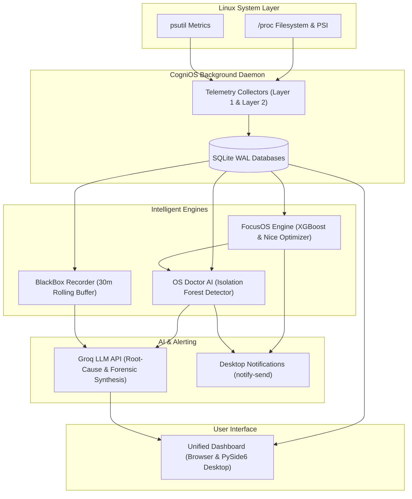

# CogniOS

### Intelligent OS Observability, Anomaly Diagnosis, Dynamic Workload Prioritization & Crash Forensics Platform

> **CogniOS** is an AI-assisted Linux system observability and adaptive workload optimization platform that operates entirely in user space without kernel patches. It combines 1-second `/proc` + Pressure Stall Information (PSI) telemetry, workload-aware **Isolation Forest** anomaly detection, **XGBoost + Deterministic Rule Engine** process prioritization (`nice` scheduling with automatic state rollback), a 30-minute **BlackBox** flight recorder with Z-score causal chains, and **Groq LLM** natural-language root-cause synthesis.

---

## Overview

Modern operating systems expose vast amounts of telemetry (`/proc/stat`, `/proc/vmstat`, `/proc/pressure/*`, `/proc/[pid]/*`), yet traditional monitoring tools only display raw counters—leaving users to correlate spikes, diagnose slowdowns, and manually adjust process priorities.

**CogniOS** closes this loop through a unified, modular daemon and interactive dashboard:

1. **Collects** multi-layer system and per-process telemetry every second into concurrent SQLite WAL databases.
2. **Classifies** the active user workload (`IDLE`, `BROWSING`, `CODING`, `COMPILATION`, `MEDIA_PROCESSING`, `GAMING`, `VIDEO_CALL`) using a hybrid Deterministic Rule Engine and **XGBoost** classifier.
3. **Optimizes** scheduling responsiveness under CPU contention by dynamically adjusting Linux `nice` values (`-10` to `+7`) for foreground vs. background processes and automatically restoring original priorities when the workload finishes.
4. **Diagnoses** abnormal system behavior using workload-specific **Isolation Forest** models (`RobustScaler` IQR baselines across 24 kernel & PSI features) paired with **Groq LLM** root-cause analysis and rate-limited desktop notifications.
5. **Records** a rolling 30-minute **BlackBox** flight recorder with heartbeat crash detection, Z-score anomaly timelines, causal forensic chains, and interactive AI post-mortem synthesis.

---

## Key Features

- **Dual-Layer Linux Telemetry Collector**: 1-second system-wide metrics (`layer1_system.py`) including Linux Pressure Stall Information (`/proc/pressure/cpu`, `memory`, `io`), `/proc/vmstat` page faults & direct reclaim, TCP retransmissions, thermal sensors, and top process peak/gradient tracking (`layer2_process.py`).
- **OS Doctor (Workload-Aware Anomaly Detection & AI Triage)**: Pre-trained per-workload **Isolation Forest** models (`idle`, `browsing`, `coding`, `gaming`) over 24 engineered features, combined with deterministic IQR baseline-deviation scoring and **Groq API** (`llama-3.3-70b-versatile`) root-cause explanations.
- **FocusOS (Adaptive Workload Classification & Scheduling Engine)**: Hybrid **XGBoost** + deterministic attribution engine with a 4-state lifecycle (`SEARCHING -> CANDIDATE -> CONFIRMED -> RESTORING`), safety-gated Linux `nice` priority boosting/throttling, and guaranteed priority rollback (`process_state.json`).
- **BlackBox Recorder (30-Minute Flight Recorder & Crash Forensics)**: Circular SQLite WAL buffer (`blackbox.db`) with daemon heartbeat tracking, systemd journal crash correlation, Z-score (`σ`) anomaly detection, causal event chain reconstruction, and interactive **Groq AI Synthesis**.
- **Responsive Unified Dashboard (Browser & Native Desktop Shell)**: Cyberpunk dark UI built with **Streamlit** + **Plotly** and wrapped in a native **PySide6 (`QWebEngineView`)** desktop application (`main.py --ui desktop` or `--ui browser`), fully responsive across full-screen and tiled Wayland/X11 window managers.
- **Smart Desktop Notifications**: Rate-limited `notify-send` alerts for critical resource thresholds, FocusOS priority adjustments, unexpected crash recoveries, and OS Doctor anomaly diagnoses.

---

## Architecture

```text
+-----------------------------------------------------------------------+
|                          LINUX SYSTEM LAYER                           |
|            /proc Filesystem (stat, vmstat, PSI)  |  psutil            |
+------------------------------------+----------------------------------+
                                     | 1s Telemetry Stream
                                     v
+-----------------------------------------------------------------------+
|                       COGNIOS BACKGROUND DAEMON                       |
|             Layer 1 System Collector  &  Layer 2 Process Collector    |
|                                    |                                  |
|                                    v                                  |
|      SQLite WAL Databases (cognios_telemetry | alerts | blackbox)     |
+-----------+------------------------+------------------------+---------+
            |                        |                        |
            v                        v                        v
+-----------------------+  +-----------------------+  +-----------------+
|    FocusOS Engine     |  |     OS Doctor AI      |  | BlackBox Engine |
|  XGBoost + Rule Attr  |->|   Workload-Specific   |  |  30m Circular   |
|  Linux Nice Priority  |  |   Isolation Forests   |  |  Flight Buffer  |
+-----------+-----------+  +-----------+-----------+  +--------+--------+
            |                          |                       |
            |                          +-----------+-----------+
            |                                      |
            v                                      v
+-----------------------+              +--------------------------------+
| Desktop Notifications |              |         Groq Cloud LLM         |
|     (notify-send)     |              |  Root-Cause & Crash Synthesis  |
+-----------------------+              +---------------+----------------+
                                                       |
                                                       v
+-----------------------------------------------------------------------+
|                       UNIFIED COGNIOS DASHBOARD                       |
|          Streamlit Browser UI  &  Native PySide6 Desktop Shell        |
+-----------------------------------------------------------------------+
```



---

## Core Modules

### 1. Collectors (`collectors/`)
Gathers low-overhead telemetry directly from the Linux kernel and `psutil`:
- **Layer 1 (`collectors/layer1_system.py`)**: Samples CPU usage, frequency deviation, context switches, memory/swap usage, `/proc/pressure/{cpu,memory,io}` (`avg10`/`avg60`), `/proc/vmstat` (`pgmajfault`, direct reclaim, swap in/out), disk throughput & I/O latency, TCP retransmission rate, thermal zones, and first-order temporal gradients.
- **Layer 2 (`collectors/layer2_process.py`)**: Tracks per-process CPU peaks, RSS memory peaks, open file descriptor counts, thread counts, and exponential moving average (EMA) baselines.

### 2. OS Doctor (`os_doctor/`)
Detects and explains performance anomalies relative to the user's current activity:
- **Workload-Specific Isolation Forests (`i_forest_predict.py`)**: Dynamically switches between 4 trained Isolation Forest models and `RobustScaler` baselines (`idle`, `browsing`, `coding`, `gaming`) based on FocusOS's live workload classification.
- **Groq LLM & Rule Diagnosis (`llm_layer.py`, `rule_diagnosis.py`)**: Correlates the worst-offending process (`CPU peak %` or `RAM peak MB`) with the most deviant system metrics (in IQR units) and queries **Groq (`llama-3.3-70b-versatile`)** to produce human-readable root causes and actionable remediation steps.

### 3. FocusOS (`focusos/`)
Classifies active workloads and adapts Linux process scheduling priorities:
- **Hybrid Classification (`models/classifier.py`, `rules/rule_engine.py`)**: Combines an **XGBoost** model trained on system telemetry with deterministic process-signature attribution (`COMPILATION`, `CODING`, `GAMING`, `MEDIA_PROCESSING`, `VIDEO_CALL`, `BROWSING`, `IDLE`).
- **Safety-Gated State Machine (`state_manager.py`, `optimisation.py`)**: Requires consecutive persistence cycles (`SEARCHING -> CANDIDATE -> CONFIRMED`) and CPU contention before adjusting process `nice` values (`-10` to `-5` for foreground toolchains; `+5` to `+7` for background noise). Automatically rolls back all modified PIDs on workload exit or Emergency Stop.

### 4. BlackBox Recorder (`blackbox/`)
Acts as the system's flight recorder for crash recovery and post-mortem forensics:
- **Rolling 30-Minute Telemetry Buffer (`recorder.py`)**: Maintains a high-speed circular buffer in `blackbox/blackbox.db` (SQLite WAL mode), automatically pruning records older than 30 minutes.
- **Heartbeat & Crash Detector (`heartbeat.py`, `replay.py`)**: Detects unexpected system freezes, power loss, or OOM kills on startup by checking heartbeat gaps and `journalctl` kernel/system logs.
- **Forensic Causal Chain & Groq Synthesis**: Computes live Z-score (`σ`) anomaly series against rolling CPU/RAM baselines, reconstructs chronological T-minus event chains, and answers natural-language forensic queries via Groq AI.

### 5. Unified Dashboard (`dashboard/`)
Interactive cyber-observability interface with 4 specialized views:
- **`system_overview.py`**: Real-time CPU, RAM, Disk I/O, Network throughput, thermal gauges, and top resource-consuming processes.
- **`os_doctor_view.py`**: Live anomaly alert stream, severity filtering, interactive PID heatmap tiles, and AI root-cause inspector.
- **`focusos_view.py`**: Active workload state banner, ML confidence radar, CPU/RAM attribution gauges, and live `nice` scheduling adjustment logs.
- **`blackbox_view.py`**: Interactive 30-minute timeline scrubber (`Live`, `-5m`, `-15m`, `-30m`), Z-Score (`σ`) anomaly chart, forensic causal chain, and Groq AI Synthesis terminal.

---

## Repository Structure

```text
CogniOS/
├── blackbox/                   # 30-minute rolling flight recorder & crash replay engine
│   ├── heartbeat.py            # Daemon heartbeat tracking & unclean shutdown detection
│   ├── llm_narrative.py        # Groq LLM crash narrative & interactive forensic Q&A
│   ├── recorder.py             # Circular SQLite WAL telemetry writer (30-min window)
│   └── replay.py               # Post-crash timeline reconstruction & statistical summary
├── collectors/                 # Multi-layer Linux telemetry collectors
│   ├── layer1_system.py        # 1s system, /proc/pressure (PSI), /proc/vmstat & thermal metrics
│   └── layer2_process.py       # Per-process CPU/RAM peaks, FD gradients & EMA baselines
├── dashboard/                  # Unified Streamlit + Plotly UI & PySide6 desktop shell
│   ├── app.py                  # Main entry point, responsive CSS, sidebar & modal dialogs
│   ├── data_provider.py        # Non-blocking SQLite data layer & Z-score/forensic builders
│   ├── desktop.py              # Native PySide6 (QWebEngineView) desktop application wrapper
│   └── views/                  # Modular dashboard tabs
│       ├── system_overview.py  # System Overview tab
│       ├── os_doctor_view.py   # OS Doctor AI tab
│       ├── focusos_view.py     # FocusOS Engine tab
│       └── blackbox_view.py    # BlackBox Recorder tab
├── focusos/                    # Workload classification & dynamic nice priority optimization
│   ├── models/                 # Trained XGBoost workload classifier & feature encoders
│   ├── rules/                  # Deterministic process-signature attribution rules
│   ├── state_manager.py        # 4-state workload lifecycle state machine
│   ├── policy.py               # Per-workload nice priority policies
│   ├── optimisation.py         # Safe os.setpriority execution & rollback engine
│   └── process_state.py        # Persistent tracking of modified PIDs for crash-safe rollback
├── os_doctor/                  # Workload-aware anomaly detection & AI root-cause engine
│   ├── models/                 # Trained Isolation Forest & RobustScaler per workload (0..3)
│   ├── featuring.py            # 24-feature extraction & scaling pipeline
│   ├── i_forest_predict.py     # Continuous workload-adaptive anomaly detection loop
│   ├── llm_layer.py            # Groq LLM root-cause diagnosis & cooldown cache
│   ├── rule_diagnosis.py       # Deterministic IQR baseline-deviation diagnosis engine
│   └── alerts_db.py            # SQLite WAL interface for alerts and diagnoses
├── packaging/linux/            # Linux CLI wrapper (cognios), desktop entry & systemd unit
├── tests/                      # Unit test suite
├── cognios_as_daemon.py        # Concurrent background daemon orchestrating all 6 worker threads
├── main.py                     # Unified launcher (--ui desktop | --ui browser)
├── notifier.py                 # Desktop notification dispatcher (notify-send)
├── config.py                   # Centralized thresholds, paths & runtime overrides
├── db.py                       # Core SQLite WAL schema and telemetry helpers
├── install.sh                  # Automated Linux system installer (/opt/cognios + systemd)
├── uninstall.sh                # Linux uninstaller with optional backup/purge
└── requirements.txt            # Python package dependencies
```

---

## Technology Stack

| Layer | Technology |
| :--- | :--- |
| **Core Language** | Python 3.10+ |
| **OS & Kernel Telemetry** | Linux `/proc` (`stat`, `vmstat`, `pressure/*`, `net/snmp`), `psutil` |
| **Storage Engine** | SQLite 3 in Write-Ahead Logging (`WAL`) mode |
| **Workload Classification** | XGBoost, scikit-learn, Deterministic Rule Attribution |
| **Anomaly Detection** | Workload-Specific Isolation Forests & `RobustScaler` (scikit-learn, joblib) |
| **AI Explainability & Synthesis** | Groq Cloud API (`llama-3.3-70b-versatile`, `llama-3.1-8b-instant`) with Gemini / Ollama fallback |
| **Frontend & Desktop UI** | Streamlit, Plotly, PySide6 (`QtWebEngineWidgets`) |
| **System Integration** | `systemd` user service, `os.setpriority`, `libnotify` (`notify-send`) |

---

## Getting Started

### Option 1: One-Command Linux Installation (Recommended)

Install the complete CogniOS project (`/opt/cognios`, isolated Python virtual environment, `cognios` CLI, desktop launcher, and `systemd` user daemon service) with a single `curl` command:

```bash
curl -fsSL https://raw.githubusercontent.com/devlup-labs/CogniOS/main/install.sh \
  | sudo env COGNIOS_REPO=devlup-labs/CogniOS bash
```

Or if you have already cloned the repository locally:

```bash
git clone https://github.com/devlup-labs/CogniOS.git
cd CogniOS
sudo bash install.sh
```

> Run the installer with `sudo` from your normal user account (not a root login) so the service and database files are owned by your user.

#### CLI Commands

```bash
cognios                    # Launch the native desktop UI (default)
cognios --ui browser       # Launch the dashboard in your browser
cognios start              # Start the background daemon service
cognios stop               # Stop the background daemon service
cognios restart            # Restart the background daemon service
cognios status             # Check daemon service status
cognios logs               # Tail live daemon logs
cognios update             # Pull latest changes and restart daemon
cognios uninstall          # Uninstall CogniOS (backs up databases & .env)
cognios uninstall --purge  # Uninstall and remove all data
```

---

### Option 2: Run from Source (Development Mode)

#### 1. Clone the Repository

```bash
git clone https://github.com/devlup-labs/CogniOS.git
cd CogniOS
```

#### 2. Configure Environment (Optional for AI Synthesis)

Create a `.env` file in the project root (or configure it directly from the **Sidebar -> Config -> AI & LLM Settings** dialog inside the dashboard):

```env
GROQ_API_KEY=gsk_your_groq_api_key_here
GROQ_MODEL=llama-3.3-70b-versatile
```

#### 3. Start the Daemon and UI

CogniOS separates the **background telemetry daemon** from the **dashboard UI**:

```bash
python3 -m venv .venv
source .venv/bin/activate
pip install -r requirements.txt

# Terminal 1: Start the background telemetry, FocusOS, BlackBox & OS Doctor daemon
python cognios_as_daemon.py

# Terminal 2: Launch the UI (native Qt desktop window by default, or browser)
python main.py --ui desktop
# Or open in your default web browser:
python main.py --ui browser
```

> **Tip:** You can also start and stop `cognios_as_daemon.py` directly from the **DAEMON RUNNING / SYSTEM IDLE** toggle button at the bottom of the dashboard sidebar, or immediately halt all background workers and roll back process priorities using the **Emergency Stop** button.

---

## Running Tests

```bash
PYTHONPATH=. .venv/bin/python -m unittest discover tests
```

---

## License

This project is released under the **MIT License**.
